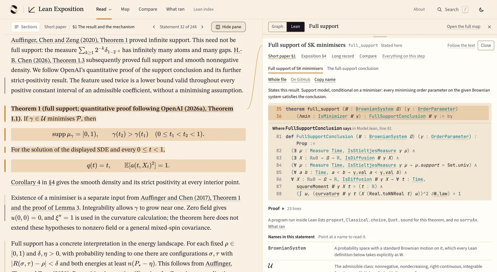

# SK Reader website

Read a mathematical paper with the exact Lean statement beside the paragraph
that describes it. Lean is a language for writing statements and proofs that a
computer can check. The papers and their links to the Lean are drafts awaiting
mathematical review.

**[Open Theorem 1 with its Lean](https://wcook04.github.io/lean-exposition-site/read/short/?l=b5970-6319&n=full_support#main-result)** · [Website](https://wcook04.github.io/lean-exposition-site/) · [Source and tools](https://github.com/wcook04/lean-exposition) · [Will Cook's projects](https://wcook04.github.io/)

The website contains three explanations of a theorem about interacting spins
in the Sherrington–Kirkpatrick model. Start with the exposition for a two-spin
example, or the short paper for the specialist statement and proof.
The mathematics comes from
[OpenAI's mathematics release, example 281](https://github.com/openai/math/blob/adc7f1241b42e322a6451854ab7e4b4c146bf78a/lean/docs/281.md).
These are drafts explaining existing results; mathematical and reader review
remain open. The [source repository](https://github.com/wcook04/lean-exposition#the-worked-example)
gives the exact scope of the Lean and the recorded checks.

## Read and explore

| Start with | What you can inspect |
| --- | --- |
| [Exposition](https://wcook04.github.io/lean-exposition-site/read/expository/) | An explanation beginning with a calculation for two spins |
| [Short paper](https://wcook04.github.io/lean-exposition-site/read/short/) | The precise mathematical statement and its proof |
| [Long reasoning record](https://wcook04.github.io/lean-exposition-site/read/long/) | Detailed calculations, source references and remaining steps for OpenAI's separate claim about the limiting energies of quantum circuits |
| [Argument map](https://wcook04.github.io/lean-exposition-site/map/) · [Compare](https://wcook04.github.io/lean-exposition-site/compare/) | The recorded proof steps and their passages in each paper |
| [Lean index](https://wcook04.github.io/lean-exposition-site/lean/) · [What ran](https://wcook04.github.io/lean-exposition-site/checks/) | The named statements in the Lean code and recorded check results |
| [About](https://wcook04.github.io/lean-exposition-site/about/) | A paper explaining how the website connects the papers to the proof steps |

A statement with a dark tick opens its Lean beside the paper.
The three explanations and the paper under About are also available in [PDF](pdf/).
[Plectis Atlas](https://wcook04.github.io/plectis-atlas/families/281.html)
lists the same OpenAI manuscripts and Lean files.

## Videos

[How different can two nearly best answers be?](https://www.youtube.com/watch?v=IUAhxUriDVw)
starts with four magnets and explains the mathematical question.
[Read a maths paper beside its argument map](https://www.youtube.com/watch?v=sYMDcT7vyng)
walks through this website.

## Source and generated files

This repository contains the built website, not the tools that produce it.
Make changes in [lean-exposition](https://github.com/wcook04/lean-exposition).
Its [main-branch build workflow](https://github.com/wcook04/lean-exposition/blob/main/.github/workflows/pages.yml)
replaces this repository's files with the built website. Installation,
local development and contribution instructions live in that source repository.

| Generated path | Contents |
| --- | --- |
| [read/](read/) | The three paper readers |
| [edition/](edition/) | Copies of the papers, proof-step data and check results used by the site |
| [pdf/](pdf/) | The three explanations and the paper about the website, as PDFs |
| [assets/](assets/) · [stills/](stills/) | Built application files and website screenshots |

Will Cook directs this project. His other projects and videos are linked below.
[Projects](https://wcook04.github.io/) · [Videos](https://www.youtube.com/@willcook2004)
